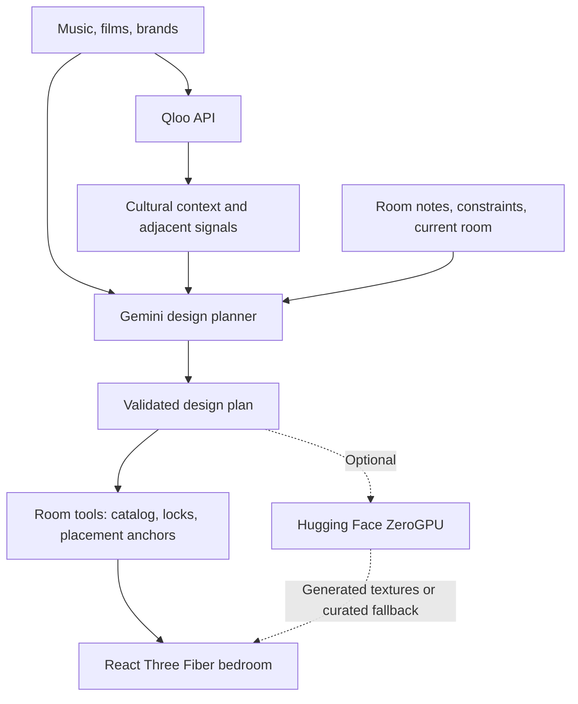

# TasteSpace

### An interior-design agent with taste.

> **Don't describe your aesthetic. Show us your taste.**

TasteSpace is an AI interior-design agent that turns the music, films, brands, and cultural worlds you love into an editable 3D bedroom. Qloo gives the agent cultural context beyond your literal prompt; TasteSpace translates that context into furniture, layout, materials, lighting, colors, artwork, and decor.

### Live Demo

**https://qloo-hackathon-five.vercel.app** — no account or special access required.

[Source code](https://github.com/ASWD13/Qloo-hackathon) · Built for the [Qloo Agentic Hackathon](https://qloo.devpost.com/).

## Why?

Most people know the culture they love, but not professional interior-design terminology. “I like rock” can invite literal posters and black furniture. TasteSpace uses a broader cultural context to help the agent form a design language instead of decorating around keywords.

## Try it

1. Select **Design my room**. Pick music, films/visual worlds, and brands, or add your own.
2. Add optional room notes: **“I want a low-lying bed and warm lighting.”** Review your tastes, choose how adventurous to be, and select **Create my room**.
3. Explore the 3D bedroom. Open **Why this room?** for its cultural references and design interpretation.
4. Select **Refine room** and try **“Keep everything but make the lighting warmer.”** Lock parts to preserve, or undo/redo changes.

For a quick preview, **View example** opens a clearly labeled curated example—not a claim of live Qloo generation.

## What it can do

- Cultural onboarding across music, films, brands, and free-form interests/design instructions.
- Qloo-grounded cultural discovery and structured interior-design planning, not just style presets.
- Five distinct bed geometries plus curated seating, storage, tables, lighting, rugs, artwork, decor, and material choices.
- Safe layout changes through predefined placement anchors; optional furniture can be removed.
- Constraints such as **“keep the walls white,” “no plants,”** and **“reading corner near the window.”**
- Scoped conversational edits, user-controlled locks, undo/redo, and an interactive browser-rendered room.
- Optional generated artwork/textiles, plus a generic-context versus Qloo-enhanced comparison.

## Why Qloo?

**Qloo gives the design agent cultural context that a literal prompt does not contain.**

### Qloo supplies cultural evidence

TasteSpace resolves selected cultural references through Qloo's `/search` endpoint, then uses resolved entity IDs with `/v2/insights` to request supported artist, movie, and brand recommendations. These adjacent signals enter the planner's context before furniture and material decisions are made. Unmatched references stay user preferences; they are not presented as verified Qloo entities.

### TasteSpace makes the design decisions

Gemini translates those signals into design intent, asset selections, palette, lighting, and layout. TasteSpace validates and executes the room tools, enforces constraints, and explains the result. Room notes feed the design planner directly; they are not automatically treated as Qloo entities.

Qloo does **not** supply wall colors, furniture styles, personality/demographic traits, embeddings, or design scores here. The exploration control varies how many returned discoveries reach planning—not a graph-distance percentage. See [Qloo capability evidence](QLOO_CAPABILITIES.md).

**Compare with generic AI** generates two fresh designs with the same model, temperature, catalog, tools, and baseline bedroom. One receives only stated tastes; the other also receives Qloo context. It demonstrates the context difference, not a measured quality-uplift score.

## How it works



The LLM cannot write arbitrary scene code or move furniture to unrestricted coordinates. It chooses from a tagged asset catalog and constrained tools. Validation checks asset IDs, locks, and layout safety; one bounded review can refine a valid plan before execution.

## Technology

| Layer | Technologies |
|---|---|
| Application | Next.js, React, TypeScript |
| Interactive 3D | React Three Fiber, Drei, Three.js |
| Interaction and validation | Motion, native CSS, Zod |
| Cultural grounding and planning | Qloo API, Gemini API |
| Optional images and hosting | Hugging Face ZeroGPU Spaces, Vercel |

## Run locally

**Prerequisites:** Node.js **22.x** and npm. No local GPU, Python backend, database, or downloaded furniture models are required.

```bash
git clone https://github.com/ASWD13/Qloo-hackathon.git
cd Qloo-hackathon
npm ci
cp .env.example .env.local
```

Edit `.env.local`; the template contains variable names only.

### Required for live design generation

- **`QLOO_API_KEY`** — obtain credentials through the [official Qloo hackathon developer guide](https://docs.qloo.com/reference/qloo-llm-hackathon-developer-guide#getting-your-api-key).
- **`QLOO_API_BASE_URL`** — use the host issued with your key. Hackathon credentials commonly use `https://hackathon.api.qloo.com`; the default is `https://api.qloo.com`. The adapter allows those two hosts and `https://staging.api.qloo.com` only.
- **`GEMINI_API_KEY`** — create a key in [Google AI Studio](https://aistudio.google.com/apikey).

### Optional settings

- `GEMINI_MODEL`: defaults to `gemini-3.1-flash-lite`; use a model available to your account.
- `HF_TOKEN`: optional [Hugging Face access token](https://huggingface.co/settings/tokens); blank uses anonymous quota.
- `HF_IMAGE_MODEL`: defaults to `black-forest-labs/FLUX.2-klein-4B`; supported alternative: `black-forest-labs/FLUX.1-schnell`.
- `HF_GENERATE_TEXTURES`: set `false` to skip image synthesis; otherwise enabled.
- `USE_MOCK_AI`: leave blank/`false` for live mode. `true` explicitly enables fixtures; **View example** also works without credentials.

Keep secrets in ignored local environment files or Vercel environment variables, never source code or `NEXT_PUBLIC_*` variables. Existing `.env` setups remain supported; `.env.local` takes precedence.

```bash
npm run dev
```

Open **http://127.0.0.1:3000**. Verify locally with:

```bash
npm test
npm run build
npm run audit:assets
```

Tests cover provider boundaries, safe layouts, constraints, scoped edits, history, and image fallbacks without live credentials. `npm run inspect:qloo` optionally makes real Qloo requests.

## Hosting and current scope

Vercel imports the repository as Next.js using Node 22.x, `npm ci`, and `npm run build`. Configure the same live credentials in Production environment variables, then deploy. `/api/health` reports configuration presence, not provider uptime.

- One fixed bedroom architecture and a curated catalog; movement stays within safe layout zones.
- No accounts or persistent saved rooms; history and locks last for the browser session.
- Optional textures use free/quota-limited hosted inference and may queue or fall back to curated local assets. Core room generation does not depend on image synthesis.
- Live Qloo/Gemini requests still require valid credentials and available provider quota. Generated textures are ephemeral and may fall back after cache eviction or serverless instance changes.

## License

Source code is released under the [MIT License](LICENSE). Third-party fonts, model weights, APIs, and services retain their respective licenses and terms. Asset, font, model, and dependency attribution is documented in [ASSET_SOURCES.md](ASSET_SOURCES.md).
